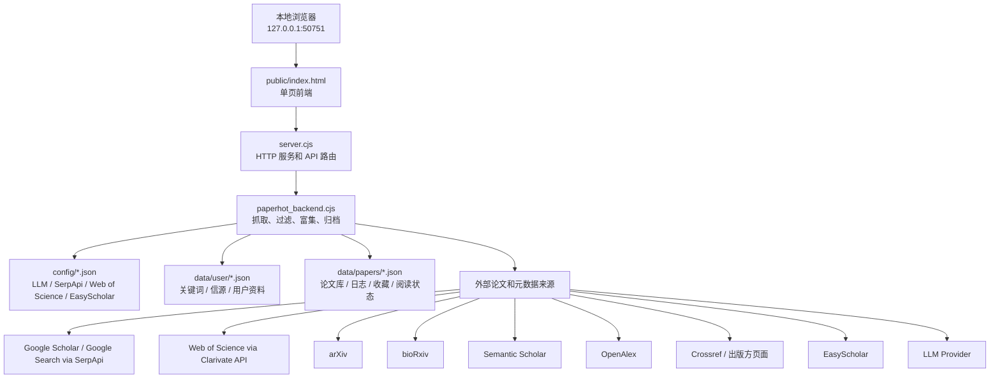

# Paper Hot

Paper Hot 是一个面向科研论文跟踪的本地 Web 工具。它把多来源论文检索、本地论文入库、摘要翻译、LLM 推荐理由、期刊指标、阅读状态和操作日志放在同一个本地页面中，适合研究者每天跟踪自己领域的新论文。

新用户首次运行时，关键词、个人研究背景和 API 配置默认为空，需要在网页的“领域配置”页面填写自己的研究方向、信源和接口信息。

## 项目的目的

Paper Hot 的主要目的只有两个：

- 从多个论文来源收集论文，减少手动搜索。
- 自动生成中文摘要，以及与个人研究背景相关的推荐理由。

## 项目特点

- 本地部署，由用户自己管理自己领域的论文；有价值的论文条目会长期保存到本地归档，用于快速检索。Paper Hot 保存的是论文条目和元数据，不是完整 PDF 文库。
- 结合期刊指标、摘要内容和领域规则辅助排序。
- 保存收藏、待读、已读、标星、短标题等个人阅读状态。
- 记录抓取、入库、删除、去重、导入导出、LLM 处理等操作，方便追溯。

## 核心功能

### 论文收集

- Google Scholar via SerpApi。
- Google Search via SerpApi。
- Web of Science via Clarivate API。
- arXiv。
- bioRxiv。
- Semantic Scholar。
- OpenAlex（需要免费 API Key）。
- Crossref 和出版方页面元数据补全。
- 方向检索把保存的 Boolean 搜索图传给信源；WoS 逐关键词加引号并保留 AND/OR 分组，使用 `modifiedTimeSpan` 限定 Starter API 的最近修改/收录窗口并按 `LD+D` 排序，bioRxiv、arXiv、Google Scholar 和 Google Search 使用各自支持的冻结日期约束。近期抓取和指定论文检索统一按任务指纹保存逐信源下一页和完成态，Google 不读取或更新旧滚动位置；`resumeMode=resume` 恢复同指纹断点，`restart` 或 `new` 从第一页开始。refresh state/start/status 接口直接返回后端的任务指纹、可恢复状态、逐信源页码、逐信源结果和错误，只有全部启用信源完成后才清除断点。
- 指定论文检索可识别 DOI、Web of Science UT、arXiv ID/URL、普通 URL 和标题；信源端不附加方向关键词或日期限制。稳定标识结果可进入现有归档，标题出现多个相近结果时只返回候选供用户确认，不写归档、缓存或抓取日志。

### 论文处理

- 论文字段归一化：保留信源原始标题，并统一显示标题、作者、摘要、DOI、URL、期刊、日期精度、来源、引用数和正式版/预印本关系。
- 关键词过滤和领域过滤。
- 日期范围筛选。
- 完整摘要并行补全：带 DOI 的论文同时查询 WoS、Semantic Scholar、OpenAlex、Crossref、出版社页面和可选 Firecrawl 出版方页面抓取；任意一个信源返回通过论文身份与完整性校验的摘要后立即调用 LLM，片段、截断文本和机器人验证页不会进入 AI。今日论文的“检索信源”开关不关闭这些字段补全路径。
- EasyScholar 期刊指标查询和缓存。
- 基于摘要、推荐理由、期刊指标和领域规则的重评分。

### 本地数据

- 全部论文归档。
- 抓取日志和候选论文快照。
- 追加式操作日志。
- 收藏、待读、已读、标星和短标题。
- 用户关键词、Boolean 搜索逻辑、信源、研究背景和外部接口配置。
- ZIP 格式的本地数据导入导出。

### 页面交互

- 今日论文抓取。
- 全部论文筛选、排序和管理。
- 个人收藏和阅读流转。
- 论文详情阅读页（`#paper/<stable-key>`），可从今日论文、全部论文和个人收藏进入。
- 浅色 / 暗色主题一键切换（仅浏览器 localStorage 偏好）。
- 领域关键词、信源和 API 配置。
- Token 统计、抓取日志、候选论文入库。
- 操作日志查看。

## 启动方式

在项目根目录运行：

```bash
npm start
```

然后打开：

```text
http://127.0.0.1:50751
```

不要直接双击或用 `file://` 打开 `public/index.html`。这个 HTML 文件是前端源码，必须通过 `server.cjs` 提供的本地服务访问；直接打开只能看到静态页面，抓取、保存、导入导出、日志、配置等需要后端 API 的功能不能正常使用。

项目默认固定使用 `50751` 端口。修改前端或后端文件后，应停止旧服务，再用同一个端口重启，然后刷新浏览器页面。维护者重启后还要核对新进程启动时间、HTTP 200 和 `data/papers/recent-fetch-cursors.json` 读写权限；只看到页面能打开，可能仍是旧进程或无法保存断点的受限进程。

## 首次配置

### 通过网页配置

推荐方式是在“领域配置”页面填写：

- 主要关键词、辅助关键词、灵感关键词。
- 启用的论文来源。
- LLM Provider、模型、Endpoint 和 API Key。
- 阿里百炼模型池只启用兼容文本对话 / Chat Completions 的模型；配置页以 5 x 5 分页卡片展示模型、PaperHot 本地剩余额度条和单模型测试按钮。测试成功会自动启用模型；已用达到 85%、剩余低于 15%、已用尽或连续失败的模型会灰掉并从自动轮换中跳过。
- SerpApi / Google Scholar 配置。
- Web of Science API 配置。
- OpenAlex 免费 API Key；配置页同时显示各论文字段的来源和回退优先级。
- EasyScholar API Key。
- Firecrawl API Key，用于抓取 DOI 对应的出版方页面并补全摘要；配置区可用“测试 Firecrawl”通过官方额度接口验证 Key，并实时显示剩余 credits、套餐 credits 和计费周期。测试不抓页面、不消耗 scrape credits，结果不写入本地数据或 ZIP。
- 学术 API 联系邮箱；Crossref 和 OpenAlex 使用该邮箱标识请求。邮箱默认不进入本地数据导出包。
- 用户研究背景和评分偏好。

如果不知道 API Key 如何获取，点击配置项旁边的 `?` 按钮，页面会显示获取步骤和对应网站链接。

### 通过 example 文件配置

也可以从模板复制：

```powershell
Copy-Item config\llm.example.json config\llm.json
Copy-Item config\google-scholar.example.json config\google-scholar.json
Copy-Item config\web-of-science.example.json config\web-of-science.json
Copy-Item config\firecrawl.example.json config\firecrawl.json
Copy-Item config\academic-apis.example.json config\academic-apis.json
Copy-Item config\openalex.example.json config\openalex.json
Copy-Item config\journal-metrics.example.json config\journal-metrics.json
Copy-Item data\user\config.example.json data\user\config.json
Copy-Item data\user\profile.example.json data\user\profile.json
```

主要配置文件：

| 文件 | 用途 |
| --- | --- |
| `config/llm.json` | LLM 提供商、模型、Endpoint、API Key |
| `config/google-scholar.json` | SerpApi、Google Scholar、Google Search 配置 |
| `config/web-of-science.json` | Web of Science API 配置 |
| `config/firecrawl.json` | Firecrawl 出版方页面摘要抓取配置 |
| `config/academic-apis.json` | Crossref 和 OpenAlex 共用的学术 API 联系邮箱 |
| `config/openalex.json` | OpenAlex Works API、免费 API Key 和分页配置 |
| `config/journal-metrics.json` | EasyScholar 期刊指标查询配置 |
| `data/user/config.json` | 关键词、Boolean 搜索逻辑、信源开关和前端领域配置 |
| `data/user/profile.json` | 用户资料、研究背景和语言偏好 |

真实 `config/*.json` 和本地 `data/papers/*` 不应提交到公共仓库；公共仓库只保留 `.example.json` 模板。

## 每一页的使用逻辑

### 今日论文

“今日论文”用于按研究方向或指定论文发起多信源抓取，并查看本次新结果。

使用逻辑：

- 在“方向检索”和“指定论文”之间切换；指定论文支持标题、DOI、Web of Science UT、arXiv ID 和 URL。
- 方向检索默认选择近 3 个月，也可快速切换近 1/6 个月或使用自定义起止日期。
- 单击关键词把它作为独立 OR 条件点亮；把关键词拖到另一个关键词会建立明确的 AND 连线，连通组之间仍为 OR。
- “检索信源”开关来自“领域配置”，只控制本次从哪些信源发现论文，不覆盖全局配置，也不关闭 Semantic Scholar、OpenAlex、Crossref 等字段补全能力。
- 页面加载或七个 discovery 字段稳定变化后，前端先调用只读 refresh state 接口检查相同 canonical 指纹的 durable 断点；点击抓取后再通过 refresh start/status 接口创建并轮询本地后端任务。
- 后端从多个信源抓取候选论文，完成过滤、补全、LLM 处理、期刊指标查询和排序。
- 本次 canonical `papers` 或指定论文候选显示在当前页面；抓取开始前已存在于全部论文的结果半透明显示，本轮新增结果正常显示，正常入库结果仍写入全部论文归档。
- 每次抓取会生成一个带日期范围和抓取时间的会话标签。
- 清除今日论文显示只清空页面上的临时结果，不删除已入库论文。

页面重点：

- “继续抓取”“从头重抓”“开始新抓取”只依据后端返回的 canonical 任务指纹和可恢复状态显示，不根据页面已显示论文数猜测断点。预检失败时保留原结果和上一次断点信息，并禁用新抓取，避免把未确认状态破坏性降级为 `new`。
- 结果按 Web of Science、Google Scholar、arXiv / bioRxiv、所有信源四个标签查看；每个标签初始显示 15 篇，接近底部后自动加载下一批 15 篇。
- 右侧悬浮窗可按六类论文类型、正式发表 / 预印本筛选，并按引用量或发表日期升降序排列；同组多选为 OR，不同组与当前信源标签、信源专属筛选和搜索条件之间为 AND，未知引用量或日期始终排在末尾。
- 右侧 GitHub 风格热点图按天显示加入全部论文的数量；点击某一天后只显示这一天的当前信源结果，再点“全部”恢复所有天。
- Web of Science 引用量、预印本平台和版本状态等信源专属筛选继续保留；日期精度筛选项已移除，但底层日期精度数据和日期处理不变。
- 论文卡标题右侧显示 WoS/Scholar 引用量；预印本显示 arXiv 或 bioRxiv。卡片同时显示最多 3 位作者和作者总数，不重复显示已经由右侧指标表达的信源标签。
- 信源分页失败会在工作台下方显示失败页和“重试失败页”，相同 canonical 条件下自动以 `resume` 继续；AI 总结失败保留论文卡片，并在对应卡片显示单篇 LLM 重试。
- 即使首次抓取在生成成功 session 前失败，页面也会按任务指纹把最小失败状态保存在浏览器本地，切换历史结果或刷新后仍可恢复；任务无错误后自动清除。该短期状态不进入本地数据 ZIP。
- 点击论文标题进入详情阅读页；该路由可刷新恢复。
- 关键词增删、OR 点亮和 AND 连线写回现有 `data/user/config.json` 的 `searchLogic`；“清空”只清除活动逻辑和连线，不删除关键词。指定论文输入、本次检索信源开关、结果标签、筛选和已加载数量都是临时页面状态。
- 旧的 Google 手动起点、重置按钮和滚动开关已移除，避免与当前任务指纹分页产生两套控制。
- 如果某些页触发反爬或失败，抓取日志会记录跳过范围，后续可以继续从后面抓。
- 最近一次抓取时间和距离当前的时间会显示在页面顶部。

只读断点预检接口：

- `POST /api/papers/refresh/state` 接收与 start 相同的 `mode`、`searchMode`、`queryExpression`、`searchLogic`、`sources`、`startDate`、`endDate` 和 `resumeMode` 请求体。
- 响应返回 `taskFingerprint`、`resumable`、`sourcePages`、`sourceResults` 和 `errors`。接口复用 start 的冻结日期和 canonical descriptor，并直接读取 durable cursor；不会创建 job、启动抓取、清除或写入 cursor。
- `POST /api/papers/refresh/start` 创建任务；`GET /api/papers/refresh/status?id=...` 只轮询该进程内的活动任务。

### 全部论文

“全部论文”用于查看和管理本地归档中的所有论文。

使用逻辑：

- 默认显示 `data/papers/archive.json` 中的论文。
- 搜索框支持普通关键词，也支持类似 `A OR B` 的任意匹配。
- 右侧悬浮窗支持全部六类论文类型和正式发表 / 预印本筛选；同组多选为 OR，不同筛选组之间为 AND。
- 搜索、关注标签、论文类型、发表阶段、时间范围和排序条件之间是 AND 关系。
- 右侧可按引用量或发表日期升降序排列，未知引用量或日期始终排在末尾。
- 抓取时间和发表时间可以点击切换正序或倒序。
- 时间节点用于快速筛选某一天、某个月或某一年范围的论文。
- 右侧 GitHub 风格热点图按天显示加入全部论文的数量；点击某一天后只显示这一天加入的论文，再点“全部”恢复所有天。
- 每次按需加载最多 20 篇，接近底部后继续加载下一批。
- 右侧筛选、排序和热点图选择均为临时页面状态，不写入论文库、用户配置或本地数据 ZIP。

论文卡片操作：

- 点击标题进入论文详情阅读页。
- 收藏论文。
- 编辑短标题。
- 手动调整论文类型标签；鼠标移到标签上可删除 AI 判断的类型，点击标签区后的加号可从剩余类型中补充人工判断，人工结果写入本地论文标注。
- 复制引用。
- 点击发表时间复制 DOI，悬停显示 DOI。
- 单篇重新运行完整摘要补全和 LLM 摘要翻译、推荐理由。
- 摘要补全失败的论文可单独使用 Firecrawl 重抓 DOI 出版方页面，或手动填写完整摘要；通过截断和机器人页校验后先保存到论文归档，再交给 AI，后续导出会随现有 `archive.json` 保留。
- 批量运行 LLM，只处理已获得至少一份身份匹配完整摘要、但缺少翻译或推荐理由的论文；只有片段、截断文本或机器人验证页时显示“未获得完整摘要，未进行 AI 分析”。
- 自动去重需要用户手动点击，不会自动删除归档内容。
- “清空未标星”一次删除全部论文归档中的未标星条目，执行前明确确认；标星论文和个人收藏、待读、已读、短标题及备注继续保留。

页面重点：

- 已收藏论文在今日论文和全部论文中会弱化显示；今日论文中抓取前已经存在于全部论文的结果也会弱化，帮助用户把注意力放在本轮新增论文上。
- 全部论文页不应自动删除论文；清空未标星、删除和去重必须由用户明确触发。

### 论文详情

“论文详情”用于连续阅读单篇论文，不伪造缺失元数据。

使用逻辑：

- 路由为 `#paper/<stable-key>`；`stable-key` 使用 `encodeURIComponent` 编码，避免 DOI/URL 中的 `/`、`#`、`?` 破坏 hash。
- 可从今日论文、全部论文、个人收藏的论文标题进入；浏览器前进/后退按 hash 历史工作，直接刷新会重新请求详情。
- 详情页左上角只显示一个上下文返回按钮；从今日论文、全部论文或个人收藏进入时，按钮返回对应来源页，直接打开详情链接时回退到全部论文。
- 从列表进入详情后视口回到详情顶部；返回来源页时恢复进入前的筛选、排序、已加载论文数量和滚动位置，不需要重新从列表开头查找。
- 返回后，该来源页最近打开的论文标题会在当前浏览器会话内显示为浅灰色下划线；今日论文、全部论文和个人收藏分别记录，重新打开另一篇论文时标记随之移动。该提示不等同于已读状态，也不写入本地数据或导出包。
- 只读接口 `GET /api/papers/by-key?key=...` 先查全部论文归档，再回退收藏快照；支持 DOI、URL、ID 和归一化标题，找不到时返回 `not-found`。该接口不修改 archive/favorites，不写操作日志。
- 详情页展示完整标题、作者、来源/期刊、日期、DOI/原文入口、摘要、AI 中文总结/推荐理由、引用，以及收藏、标星、已读、短标题等现有阅读状态操作。
- 缺失字段保持空白或“未记录”，不会伪造发表日期或其他元数据。
- 找不到论文或加载失败时显示明确错误，并保留同一个上下文返回按钮。

页面重点：

- 详情页复用现有字段语义和收藏 / notes API，不另建一套阅读状态。
- 若论文只存在于收藏快照而不在归档中，详情内容以快照已有字段为准。

引文谱系：

- 详情页下方展示论文的引文谱系图，分上排前置论文和下排后续论文，数据来自 OpenAlex 与 Semantic Scholar 并行拉取、Crossref 兜底；DOI 归一化去重，字段取更完整一方。
- 本地论文库中命中的论文全部保留，其余外部论文按高影响力引用和被引次数补充到每排目标约 6 篇；本地命中超过目标时不截断。
- 节点优先显示用户实际填写的短标题；精确的 `YYYY@` 或 `n.d.@` 默认占位符视为未设置并回退完整原标题。完整标题按节点可用宽度换行且不使用省略号截断，窄屏横向滚动只发生在谱系区域内。
- 节点大小按引用量使用有上限的对数尺度变化，避免极高引用量破坏布局；悬停信息继续显示精确被引次数，引用量未知时使用基础大小。
- 节点悬停显示标题、期刊、年份、被引次数和摘要片段；点击本地库论文进入现有详情页，点击外部论文进入临时详情页，可选择"加入论文库"（加入时记录操作日志；不点击则不写入本地数据）。
- 一路追溯经过的论文在图中金色高亮，帮助用户沿着研究脉络查阅相关论文。无 DOI 或信源未收录时显示"暂无谱系数据"，不伪造元数据。
- 谱系磁盘缓存 `data/papers/lineage/` 有 30 天有效期；缓存可随时从外部信源重新计算，属于运行时缓存，不进入一键导出 ZIP，追溯路径为会话内状态不持久化。

### 主题与显示

- 默认保持现有浅色主题视觉不变。
- 侧栏顶栏提供一键浅色 / 暗色切换；偏好保存在浏览器 `localStorage` 的版本化键 `paperhot.theme.v1`，刷新后恢复。
- 主题偏好不写入 `config.json`，不进入本地数据 ZIP 导入导出，也不改变备份格式 v1。

### 个人收藏

“个人收藏”用于管理用户明确关注的论文。

子页面：

- 已收藏论文。
- 待读论文。
- 已阅读论文。
- 标星论文。

使用逻辑：

- 默认打开待读论文。
- 收藏状态写入 `data/papers/favorites.json`。
- 收藏论文已不在全部论文归档时，收藏页会回退显示 `favorites.json` 中已有的论文快照，待读、已读和备注状态不丢失。
- 右侧“个人收藏筛选”支持关注标签、论文类型、发表阶段和引用量 / 发表日期排序；筛选只影响当前页面显示。
- 右侧 GitHub 风格热点图按天显示收藏论文数量；点击某一天后只显示当天收藏的论文，再点“全部”恢复所有天。
- 短标题、已读、标星和人工论文类型标签写入 `data/papers/paper-notes.json`。
- 点击“标记已读”后，论文在 3 秒内淡出，并出现“撤销”按钮。
- 3 秒内点击撤销，论文保留在待读页面。
- 3 秒后未撤销，论文进入已阅读页面。
- 已阅读页面可以点击“未阅读”，让论文回到待读页面。
- 删除按钮会把论文从收藏页移除。
- 收藏页内的论文都是已收藏论文，所以不再弱化显示背景。
- 标星论文卡片使用浅金色星纹背景，和普通白色卡片直接区分；标星状态仍写入现有 `paper-notes.json`。
- 点击标题同样进入论文详情阅读页。

页面重点：

- 短标题默认格式是 `年份@`（无年份时为 `n.d.@`），后面的技术缩写由用户填写；只有默认前缀而没有实际内容时等同于尚未设置短标题。
- LLM 按钮可以刷新收藏论文的大模型总结。

### 领域配置

“领域配置”用于维护项目输入条件和外部接口。

使用逻辑：

- 左侧主栏依次显示“首次配置状态、学术 API 联系邮箱、论文字段来源与优先级、信源配置、Firecrawl 出版方摘要补全、外部接口配置”；后三项默认收起，领域关键词继续位于右侧，本地数据位于这些配置项之后。
- 配置关键词和关注领域。
- 启用或暂停各个信源。
- 配置 LLM、SerpApi 和 EasyScholar。
- 点击 `?` 查看 API 获取说明和对应网站。
- 保存接口时，空的 API Key 字段表示保留已有密钥。
- 首次配置状态会提示哪些配置还缺失。
- Web of Science 卡片显示 PaperHot 本地统计的今日、本月、累计请求量、月度历史和最后请求状态；这是本地计数，不代表 Clarivate 官方额度。

本地数据导入导出：

- 导出默认包含本地论文库、收藏、待读、已读和标星，以及 `data/user/config.json` 中的关键词、Boolean 搜索逻辑和信源开关。
- 可以选择是否包含统计缓存、WoS 本地请求用量、抓取日志、操作日志、用户资料、API Key。
- `recent-fetch-cursors.json` 是设备相关的短期断点，在任何导出选项下都不会进入 ZIP；勾选统计时导出的 WoS 用量可以恢复到另一台设备。
- 导出默认不包含 API Key。
- 导入默认不覆盖本机 API Key。
- 只有勾选“允许导入并覆盖本机 API Key”后，导入包里的接口配置才会写入本机。
- 旧版用户配置或备份缺少 `searchLogic` 时，会把原有仍处于启用状态的关键词作为默认活动关键词，无需手动迁移。

页面重点：

- 可配置功能如果需要跨设备保留，维护者必须同步纳入导入导出逻辑。
- 涉及 API Key、访问令牌和个人研究背景的导出必须由用户显式勾选。

### 统计

“统计”用于查看 LLM Token 使用和抓取日志。

使用逻辑：

- 显示今日、近 7 天、近 30 天的 Token 统计。
- 按模型展示调用情况。
- 显示阿里百炼模型池当前模型、各模型本地已用 Token、估算剩余额度、连续失败次数和“上次因连续失败切换”提示，并可重置 PaperHot 本地估算；重置不会恢复阿里云真实免费额度。
- 展示最近抓取日志。
- 抓取日志保留每次抓取的来源、数量、时间范围、候选论文快照和失败信息；新日志同时记录日期粗筛、Crossref/出版社补全后及最终日期通过数量。
- 可以打开某次抓取的候选论文详情，在“领域过滤前、日期粗筛、日期补全后、最终日期通过”之间切换；补全后的两个阶段显示最终确认日期。
- 候选论文详情中可以把论文加入全部论文。
- 失败的 enrichment 任务可以从失败论文处重试，而不是从头搜索。

页面重点：

- 抓取日志用于诊断为什么某次没有抓到论文。
- 候选快照保留关键过滤阶段，便于区分“日期没有补全”和“日期补全后超出范围”两种情况；旧日志未保存的历史日期无法反推。

### 日志

“日志”用于查看本地操作记录。

使用逻辑：

- 读取 `data/papers/operation-log.jsonl`。
- 记录新增、删除、修改、导入、去重、LLM 处理等操作。
- 日志文件只追加，不自动清理。
- 页面提供刷新按钮。

页面重点：

- 用于追溯为什么全部论文数量变多、变少或某篇论文状态发生变化。
- 维护者新增会改变本地数据的功能时，应补充对应操作日志。

### 关于

“关于”用于简要说明 Paper Hot 的定位。当前主要作为产品说明页，后续可以补充版本号、维护者说明和更新日志入口。

## 论文入库流程

点击抓取后，前端不会直接访问外部论文网站，而是向本地后端创建抓取任务。后端流程如下：

1. 读取用户配置：关键词、信源、日期范围、LLM、SerpApi、Web of Science、EasyScholar。
2. 多来源检索：Google Scholar、Google Search、Web of Science、arXiv、bioRxiv、Semantic Scholar、OpenAlex；方向检索传递 Boolean 条件和信源支持的冻结日期。WoS 查询把每个关键词加引号，使用 `modifiedTimeSpan` 和 `LD+D` 获取时间窗内最近修改/收录记录；分页恢复会跳过已完成信源，并从未完成信源保存的下一页继续。
3. 候选归一化：保留信源原始标题，统一显示标题、摘要、作者、DOI、URL、来源、日期精度和引用数据库；同版本精确重复按信源优先级保留，正式版与预印本分别保留并互相关联。
4. 关键词和领域过滤：WoS 的 `TS` 命中直接进入候选池，避免 Starter 响应缺少摘要或命中字段时被本地重复删除；Google、arXiv 等信源继续按保存的 Boolean 搜索图和领域上下文过滤。指定论文检索跳过方向、领域和日期过滤，标题多候选不自动入库。
5. 日期筛选：按前端选择范围筛选；只有年月或年份时按该月或该年与范围是否重叠决定保留，不伪造 `YYYY-01-01` 作为真实日期。
6. 初步排序：用本地规则控制进入后续富集的候选数量。
7. 元数据补全：优先读取 WoS 年月；已有 DOI 仍直接查询 Crossref，并在 online、print、published、issued 中选择精度最高的日期；仍不足到日时通过 DOI 出版方页面补全。
8. 完整摘要与 LLM：并行查询 WoS DOI、Semantic Scholar DOI、OpenAlex DOI、Crossref abstract、出版社页面和可选 Firecrawl 出版方页面；OpenAlex 的倒排摘要先还原为正文。每份结果再校验 DOI/标题身份及摘要完整性，第一份通过校验的完整摘要立即交给 LLM；片段、截断文本、机器人验证页或身份不匹配内容不调用 LLM。
9. 期刊指标：通过 EasyScholar 查询影响因子和分区，并写入缓存。
10. 最终重评分：结合摘要、LLM 推荐理由、期刊指标和领域规则。
11. 写入归档：新论文追加到 `data/papers/archive.json`。
12. 写入日志：抓取日志和操作日志记录本次流程。

默认原则：

- 抓到并入库的论文不应被自动删除。
- 自动去重只有用户点击后才执行。
- 删除论文只有用户点击删除后才执行。
- 只拿到年份时只能显示年份，不能伪造具体日期。

## 项目架构



### 主要文件

| 路径 | 作用 |
| --- | --- |
| `server.cjs` | 本地 HTTP 服务入口，提供静态页面和 API 路由 |
| `paperhot_backend.cjs` | 核心业务逻辑：抓取、过滤、补全、LLM、期刊指标、归档、日志 |
| `public/index.html` | 单页前端，包含所有主要页面和交互 |
| `test/paperhot_backend.test.cjs` | 后端行为测试 |
| `test/paperhot_frontend.test.cjs` | 前端静态行为测试 |
| `config/*.example.json` | 可提交的接口配置模板 |
| `data/user/*.example.json` | 可提交的用户配置模板 |
| `CHANGELOG.md` | 项目更新日志 |
| `AGENTS.md` | 维护者和 AI 协作规则 |
| `claude.md` | Claude / Claude Code 使用的协作规则入口；修改 `AGENTS.md` 或 `claude.md` 任意一份时，必须同步另一份 |
| `BACKUP_FORMAT.md` | 本地数据 ZIP 备份格式、版本号和迁移规则 |
| `ROADMAP.md` | 后续计划和暂不计划的功能方向 |

### 主要文件夹

| 文件夹 | 作用 | 是否建议上传 GitHub |
| --- | --- | --- |
| `config/` | 外部接口配置模板目录。GitHub 上只保留 `*.example.json`，用于告诉新用户如何填写 LLM、SerpApi、WoS、OpenAlex、EasyScholar、Firecrawl 和学术 API 联系邮箱；真实 `*.json` 可能包含 API Key 或个人邮箱，应保留在本机并被 `.gitignore` 忽略。 | 是，只上传 `*.example.json` |
| `docs/` | 补充文档目录，包含 API 获取与配置说明、论文入库流程说明等。它不是运行必需目录，但对维护者排查配置、理解入库流程和新用户上手有帮助。 | 是 |
| `public/` | 前端页面目录，目前主要是 `index.html`。必须通过 `http://127.0.0.1:50751` 访问，不要直接双击打开。 | 是 |
| `test/` | 后端和前端测试目录，用于验证抓取、导入导出、阅读状态、UI 结构等行为。 | 是 |
| `scripts/` | 维护脚本目录，目前包含发布前归档 changelog 的脚本。只提交通用维护脚本，不提交依赖个人环境的一次性脚本。 | 是，限通用脚本 |
| `data/` | 本地用户数据目录。GitHub 上只保留 example 文件；真实论文库、收藏、日志和用户资料应保留在本机。 | 只上传 example |

### 补充文档

`docs/solutions/` 保存已经解决并验证的故障、踩坑经验和可复用修复方案，按问题类别组织，并用 YAML frontmatter 的 `module`、`problem_type`、`tags` 等字段支持检索；实现功能或排查同类问题时可先查对应分类。

`docs/decisions/` 保存 ADR 设计决策，记录公共 API、数据边界和难以从代码直接看出的取舍；修改相关架构前应先查看现有决策及其状态。

| 路径 | 用途 |
| --- | --- |
| `docs/easyscholar-config.md` | EasyScholar API 获取和期刊指标配置说明 |
| `docs/google-scholar-config.md` | SerpApi / Google Scholar 配置说明 |
| `docs/paperhot-ingestion-flow.html` | 从页面抓取按钮到归档、日志和富集流程的可视化说明 |
| `docs/decisions/ADR-001-paper-detail-navigation-and-lookup.md` | 论文详情采用 hash 路由、只读按键查询及现有阅读状态复用的设计取舍 |
| `docs/superpowers/specs/2026-07-11-recent-paper-discovery-design.md` | 已确认的近期论文发现、多信源检索、断点恢复和今日论文页面设计 |
| `docs/superpowers/specs/2026-07-15-archive-clear-and-existing-results-design.md` | 全部论文清除未标星条目、保留个人状态及今日论文显示已入库结果的设计 |
| `docs/superpowers/specs/2026-07-15-wos-date-and-query-design.md` | WoS Boolean 查询、近期收录范围与多级论文日期补全设计 |
| `docs/superpowers/specs/2026-07-15-complete-abstract-consensus-design.md` | 完整摘要并行补全、单源完整性门禁与 Firecrawl 兜底设计 |
| `docs/superpowers/specs/2026-07-16-academic-api-contact-email-design.md` | Crossref 当前使用、OpenAlex 未来复用的学术 API 联系邮箱配置与隐私边界设计 |
| `docs/superpowers/specs/2026-07-16-openalex-discovery-enrichment-design.md` | OpenAlex 检索、独立字段补全、配置页字段来源与优先级设计 |
| `docs/superpowers/specs/2026-07-16-paper-list-filter-sort-design.md` | 今日论文与全部论文的分类、发表阶段和引用量 / 发表日期排序设计 |
| `docs/superpowers/specs/2026-07-17-aliyun-llm-model-pool-design.md` | 阿里百炼免费额度优先、本地估算兜底的 LLM 模型池自动切换设计 |
| `docs/superpowers/specs/2026-07-17-aliyun-text-model-pool-manager-design.md` | 阿里百炼文本对话模型池管理器、25/页模型卡片、单模型测试和灰度切换设计 |
| `docs/superpowers/specs/2026-07-22-paperhot-visual-optimization-design.md` | 以今日论文快速扫描为核心的视觉层级、语义状态、论文卡、响应式和性能验收设计 |
| `docs/superpowers/specs/2026-07-26-citation-lineage-graph-design.md` | 论文详情页引文谱系点线图、多信源并行合并去重与外部论文临时详情页设计 |
| `docs/superpowers/plans/2026-07-11-recent-paper-discovery.md` | 近期论文发现功能的分步实现、测试和验证计划 |
| `docs/superpowers/plans/2026-07-15-archive-clear-and-existing-results.md` | 全部论文清理、收藏快照回退和今日论文已入库弱化展示的 TDD 实施计划 |
| `docs/superpowers/plans/2026-07-15-wos-date-and-query.md` | WoS 查询和论文日期补全的 TDD 实施计划 |
| `docs/superpowers/plans/2026-07-15-complete-abstract-consensus.md` | 完整摘要单源放行、Firecrawl 配置与无完整摘要禁用 LLM 的 TDD 实施计划 |
| `docs/superpowers/plans/2026-07-16-academic-api-contact-email.md` | 学术 API 联系邮箱、Crossref 请求身份与敏感配置备份的 TDD 实施计划 |
| `docs/superpowers/plans/2026-07-16-openalex-discovery-enrichment.md` | OpenAlex 检索、自动字段补全、配置与验证的分步实施计划 |
| `docs/superpowers/plans/2026-07-16-paper-list-filter-sort.md` | 今日论文与全部论文分类、发表阶段和排序功能的 TDD 实施计划 |
| `docs/superpowers/plans/2026-07-17-aliyun-llm-model-pool.md` | 阿里百炼 LLM 模型池自动切换、状态可视化和本地额度估算的 TDD 实施计划 |
| `docs/superpowers/plans/2026-07-17-aliyun-text-model-pool-manager.md` | 阿里百炼文本对话模型池管理器、单模型测试和 25/页卡片 UI 的 TDD 实施计划 |
| `docs/superpowers/plans/2026-07-23-paperhot-visual-optimization.md` | 今日论文视觉令牌、结果层级、论文卡、移动端、性能测量和固定端口验收的分步实施计划 |
| `docs/superpowers/plans/2026-07-26-citation-lineage-graph.md` | 引文谱系图后端信源合并、前端 SVG 图与外部论文临时详情页的 TDD 实施计划 |
| `docs/solutions/runtime-errors/paperhot-service-restart-data-permission.md` | 固定端口旧进程与受限 Node 导致旧代码、断点 `EPERM` 的诊断和重启验收 |
| `docs/solutions/ui-bugs/hash-routed-paper-detail-survives-async-rerenders.md` | 详情 hash 路由、上下文返回、列表状态恢复及最近标题标记的修复与防回归规则 |
| `docs/solutions/ui-bugs/citation-lineage-title-layout-and-placeholder-fallback.md` | 引文谱系完整标题换行、默认短标题占位回退、引用量节点尺度与窄屏溢出的修复规则 |
| `.superpowers/sdd/task-2-report.md` | Task 2 多信源元数据与正式版/预印本关联的实现、TDD 和验证报告 |
| `.superpowers/sdd/task-3-report.md` | Task 3 近期抓取游标与 WoS 本地请求用量的实现、TDD 和验证报告 |
| `.superpowers/sdd/task-4-report.md` | Task 4 日期感知、断点恢复、指定论文检索及独立审查修复的 TDD 和验证报告 |
| `.superpowers/sdd/task-5-report.md` | Task 5 现有 refresh job 请求、恢复与轮询状态契约的 TDD 和验证报告 |
| `.superpowers/sdd/task-6-report.md` | Task 6 今日论文工作台、关键词关系图、canonical 恢复按钮与分信源自动加载的 TDD 和浏览器验证报告 |

### 主要数据文件

| 路径 | 作用 |
| --- | --- |
| `data/papers/archive.json` | 全部论文归档 |
| `data/papers/fetch-log.json` | 抓取日志和候选论文快照 |
| `data/papers/operation-log.jsonl` | 追加式操作日志 |
| `data/papers/favorites.json` | 收藏论文状态 |
| `data/papers/paper-notes.json` | 短标题、已读、标星和人工论文类型标签等阅读状态 |
| `data/papers/journal-metrics-cache.json` | EasyScholar 期刊指标缓存 |
| `data/papers/google-rolling-cursors.json` | 旧版直接 Google adapter 调用的滚动抓取位置；近期抓取和指定论文检索不读取或更新 |
| `data/papers/recent-fetch-cursors.json` | 近期抓取和指定论文检索的唯一短期断点；Google、WoS、arXiv 等逐信源只保存下一页和完成态，仅相同检索模式、表达式、日期和信源任务可续传，全部信源完成后清除，不进入本地数据 ZIP |
| `data/papers/web-of-science-usage.json` | PaperHot 本地记录的 WoS 请求日/月/累计次数及最后状态；不保存请求 URL、Header 或 API Key，勾选统计时进入 v1 ZIP 并可导回 |
| `data/papers/llm-model-pool-state.json` | PaperHot 本地记录的阿里百炼模型池 Token 估算、失败次数和当前状态；不保存 API Key，勾选统计时进入 v1 ZIP 并可导回 |
| `data/papers/*.example.json` | 可提交的运行态 JSON 示例模板；真实运行文件继续只保留在本机 |

## 维护者统一任务流程

详细维护规则放在 `AGENTS.md`，README 只保留维护入口。改动项目时请遵守以下简版流程：

- 先阅读 `AGENTS.md`，确认固定端口、更新日志、导入导出、敏感文件和发布规则。
- 每次代码或文档改动都同步更新 `CHANGELOG.md` 的 `未发布` 区域。
- 新增可配置状态时，同步判断是否应进入本地数据 ZIP 导入导出。
- 涉及论文库增删改、去重、导入导出或 LLM 处理时，同步考虑操作日志和测试。
- 提交前检查 `git status --short`，不要提交真实 API Key、本地论文库、个人资料或私密导出包。
- 普通维护者提交 PR 时只更新 `CHANGELOG.md` 的 `未发布` 区域，不修改 `package.json` 版本号、不新增版本标题、不打 tag。
- 发布前运行发布流程，把 `CHANGELOG.md` 的 `未发布` 内容归档到版本号和日期下面。

常用验证命令：

```bash
npm test
```

也可以分别运行：

```bash
npm run test:backend
npm run test:frontend
node --check paperhot_backend.cjs
node --check server.cjs
```

## 隐私和本地数据

Paper Hot 默认把用户数据保存在本地：

- API Key 写入 `config/*.json`。
- 论文和阅读状态写入 `data/papers/*.json`。
- 关键词和个人资料写入 `data/user/*.json`。

导出本地数据时：

- 默认不包含 API Key。
- 默认不覆盖本机 API Key。
- 包含 API Key 的 ZIP 只适合在自己的设备之间迁移。
- 不应把包含 API Key、个人研究背景或真实论文库的 ZIP 上传到公共仓库或发给他人。

## 开源使用方式

其他用户拿到项目后，典型流程是：

1. 克隆项目。
2. 运行 `npm start`。
3. 打开 `http://127.0.0.1:50751`。
4. 在“领域配置”页面填写自己的 API、关键词、信源和研究背景。
5. 在“今日论文”页面按日期范围抓取论文。
6. 在“全部论文”和“个人收藏”页面管理自己的论文库。

Paper Hot 的目标是让每个研究者都能在本地维护一套属于自己领域的论文热点数据库。
