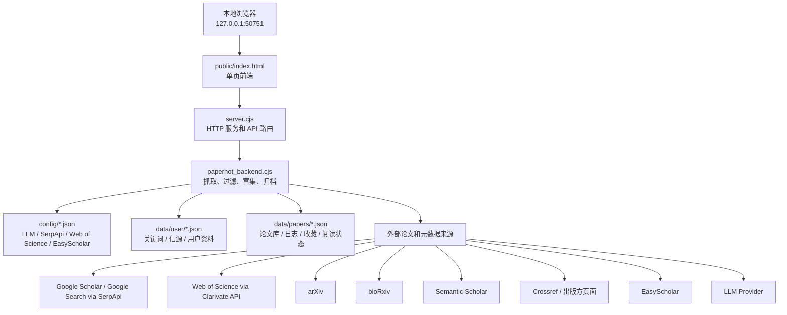

# Paper Hot

Paper Hot 是一个面向科研论文跟踪的本地 Web 工具。它把多来源论文检索、本地论文入库、摘要翻译、LLM 推荐理由、期刊指标、阅读状态和操作日志放在同一个本地页面中，适合研究者每天跟踪自己领域的新论文。

新用户首次运行时，关键词、个人研究背景和 API 配置默认为空，需要在网页的“领域配置”页面填写自己的研究方向、信源和接口信息。

## 项目的目的

Paper Hot 的主要目的只有两个：

- 从多个论文来源收集论文，减少手动搜索。
- 自动生成中文摘要，以及与个人研究背景相关的推荐理由。

## 项目特点

- 本地部署，由用户自己管理自己领域的论文；有价值的论文条目会长期保存到本地归档，用于快速检索。Paper Hot 保存的是论文条目和元数据，不是完整 PDF 文库。
- 结合期刊指标、摘要内容和领域规则辅助排序。
- 保存收藏、待读、已读、标星、短标题等个人阅读状态。
- 记录抓取、入库、删除、去重、导入导出、LLM 处理等操作，方便追溯。

## 核心功能

### 论文收集

- Google Scholar via SerpApi。
- Google Search via SerpApi。
- Web of Science via Clarivate API。
- arXiv。
- bioRxiv。
- Semantic Scholar。
- Crossref 和出版方页面元数据补全。
- 方向检索把保存的 Boolean 搜索图传给信源；WoS、bioRxiv、arXiv、Google Scholar 和 Google Search 使用各自支持的冻结日期约束。近期抓取和指定论文检索统一按任务指纹保存逐信源下一页和完成态，Google 不读取或更新旧滚动位置；`resumeMode=resume` 恢复同指纹断点，`restart` 或 `new` 从第一页开始。refresh state/start/status 接口直接返回后端的任务指纹、可恢复状态、逐信源页码、逐信源结果和错误，只有全部启用信源完成后才清除断点。
- 指定论文检索可识别 DOI、Web of Science UT、arXiv ID/URL、普通 URL 和标题；信源端不附加方向关键词或日期限制。稳定标识结果可进入现有归档，标题出现多个相近结果时只返回候选供用户确认，不写归档、缓存或抓取日志。

### 论文处理

- 论文字段归一化：保留信源原始标题，并统一显示标题、作者、摘要、DOI、URL、期刊、日期精度、来源、引用数和正式版/预印本关系。
- 关键词过滤和领域过滤。
- 日期范围筛选。
- LLM 摘要翻译和推荐理由生成。
- EasyScholar 期刊指标查询和缓存。
- 基于摘要、推荐理由、期刊指标和领域规则的重评分。

### 本地数据

- 全部论文归档。
- 抓取日志和候选论文快照。
- 追加式操作日志。
- 收藏、待读、已读、标星和短标题。
- 用户关键词、Boolean 搜索逻辑、信源、研究背景和外部接口配置。
- ZIP 格式的本地数据导入导出。

### 页面交互

- 今日论文抓取。
- 全部论文筛选、排序和管理。
- 个人收藏和阅读流转。
- 领域关键词、信源和 API 配置。
- Token 统计、抓取日志、候选论文入库。
- 操作日志查看。

## 启动方式

在项目根目录运行：

```bash
npm start
```

然后打开：

```text
http://127.0.0.1:50751
```

不要直接双击或用 `file://` 打开 `public/index.html`。这个 HTML 文件是前端源码，必须通过 `server.cjs` 提供的本地服务访问；直接打开只能看到静态页面，抓取、保存、导入导出、日志、配置等需要后端 API 的功能不能正常使用。

项目默认固定使用 `50751` 端口。修改前端或后端文件后，应停止旧服务，再用同一个端口重启，然后刷新浏览器页面。

## 首次配置

### 通过网页配置

推荐方式是在“领域配置”页面填写：

- 主要关键词、辅助关键词、灵感关键词。
- 启用的论文来源。
- LLM Provider、模型、Endpoint 和 API Key。
- SerpApi / Google Scholar 配置。
- Web of Science API 配置。
- EasyScholar API Key。
- 用户研究背景和评分偏好。

如果不知道 API Key 如何获取，点击配置项旁边的 `?` 按钮，页面会显示获取步骤和对应网站链接。

### 通过 example 文件配置

也可以从模板复制：

```powershell
Copy-Item config\llm.example.json config\llm.json
Copy-Item config\google-scholar.example.json config\google-scholar.json
Copy-Item config\web-of-science.example.json config\web-of-science.json
Copy-Item config\journal-metrics.example.json config\journal-metrics.json
Copy-Item data\user\config.example.json data\user\config.json
Copy-Item data\user\profile.example.json data\user\profile.json
```

主要配置文件：

| 文件 | 用途 |
| --- | --- |
| `config/llm.json` | LLM 提供商、模型、Endpoint、API Key |
| `config/google-scholar.json` | SerpApi、Google Scholar、Google Search 配置 |
| `config/web-of-science.json` | Web of Science API 配置 |
| `config/journal-metrics.json` | EasyScholar 期刊指标查询配置 |
| `data/user/config.json` | 关键词、Boolean 搜索逻辑、信源开关和前端领域配置 |
| `data/user/profile.json` | 用户资料、研究背景和语言偏好 |

真实 `config/*.json` 和本地 `data/papers/*` 不应提交到公共仓库；公共仓库只保留 `.example.json` 模板。

## 每一页的使用逻辑

### 今日论文

“今日论文”用于按研究方向或指定论文发起多信源抓取，并查看本次新结果。

使用逻辑：

- 在“方向检索”和“指定论文”之间切换；指定论文支持标题、DOI、Web of Science UT、arXiv ID 和 URL。
- 方向检索默认选择近 3 个月，也可快速切换近 1/6 个月或使用自定义起止日期。
- 单击关键词把它作为独立 OR 条件点亮；把关键词拖到另一个关键词会建立明确的 AND 连线，连通组之间仍为 OR。
- 本次信源开关来自“领域配置”，只影响当前抓取，不覆盖全局配置。
- 页面加载或七个 discovery 字段稳定变化后，前端先调用只读 refresh state 接口检查相同 canonical 指纹的 durable 断点；点击抓取后再通过 refresh start/status 接口创建并轮询本地后端任务。
- 后端从多个信源抓取候选论文，完成过滤、补全、LLM 处理、期刊指标查询和排序。
- 本次 canonical `newPapers` 或指定论文候选显示在当前页面，正常入库结果同时写入全部论文归档。
- 每次抓取会生成一个带日期范围和抓取时间的会话标签。
- 清除今日论文显示只清空页面上的临时结果，不删除已入库论文。

页面重点：

- “继续抓取”“从头重抓”“开始新抓取”只依据后端返回的 canonical 任务指纹和可恢复状态显示，不根据页面已显示论文数猜测断点。预检失败时保留原结果和上一次断点信息，并禁用新抓取，避免把未确认状态破坏性降级为 `new`。
- 结果按 Web of Science、Google Scholar、arXiv / bioRxiv、所有信源四个标签查看；每个标签初始显示 15 篇，接近底部后自动加载下一批 15 篇。
- 关键词增删、OR 点亮和 AND 连线写回现有 `data/user/config.json` 的 `searchLogic`；“清空”只清除活动逻辑和连线，不删除关键词。指定论文输入、本次信源开关、结果标签、筛选和已加载数量都是临时页面状态。
- 旧的 Google 手动起点、重置按钮和滚动开关已移除，避免与当前任务指纹分页产生两套控制。
- 如果某些页触发反爬或失败，抓取日志会记录跳过范围，后续可以继续从后面抓。
- 最近一次抓取时间和距离当前的时间会显示在页面顶部。

只读断点预检接口：

- `POST /api/papers/refresh/state` 接收与 start 相同的 `mode`、`searchMode`、`queryExpression`、`searchLogic`、`sources`、`startDate`、`endDate` 和 `resumeMode` 请求体。
- 响应返回 `taskFingerprint`、`resumable`、`sourcePages`、`sourceResults` 和 `errors`。接口复用 start 的冻结日期和 canonical descriptor，并直接读取 durable cursor；不会创建 job、启动抓取、清除或写入 cursor。
- `POST /api/papers/refresh/start` 创建任务；`GET /api/papers/refresh/status?id=...` 只轮询该进程内的活动任务。

### 全部论文

“全部论文”用于查看和管理本地归档中的所有论文。

使用逻辑：

- 默认显示 `data/papers/archive.json` 中的论文。
- 搜索框支持普通关键词，也支持类似 `A OR B` 的任意匹配。
- 右侧标签筛选互相之间是 OR 关系。
- 搜索、标签、抓取时间、发表时间、排序条件之间是 AND 关系。
- 抓取时间和发表时间可以点击切换正序或倒序。
- 时间节点用于快速筛选某一天、某个月或某一年范围的论文。
- 每次按需加载最多 20 篇，接近底部后继续加载下一批。

论文卡片操作：

- 收藏论文。
- 编辑短标题。
- 复制引用。
- 点击发表时间复制 DOI，悬停显示 DOI。
- 单篇重新运行 LLM 摘要翻译和推荐理由。
- 批量运行 LLM，只处理缺少翻译或总结的论文。
- 自动去重需要用户手动点击，不会自动删除归档内容。

页面重点：

- 已收藏论文在今日论文和全部论文中会弱化显示，帮助用户把注意力放在未处理论文上。
- 全部论文页不应自动删除论文；删除和去重必须由用户明确触发。

### 个人收藏

“个人收藏”用于管理用户明确关注的论文。

子页面：

- 已收藏论文。
- 待读论文。
- 已阅读论文。
- 标星论文。

使用逻辑：

- 默认打开待读论文。
- 收藏状态写入 `data/papers/favorites.json`。
- 短标题、已读、标星状态写入 `data/papers/paper-notes.json`。
- 点击“标记已读”后，论文在 3 秒内淡出，并出现“撤销”按钮。
- 3 秒内点击撤销，论文保留在待读页面。
- 3 秒后未撤销，论文进入已阅读页面。
- 已阅读页面可以点击“未阅读”，让论文回到待读页面。
- 删除按钮会把论文从收藏页移除。
- 收藏页内的论文都是已收藏论文，所以不再弱化显示背景。

页面重点：

- 短标题默认格式是 `年份@`，后面的技术缩写由用户填写。
- LLM 按钮可以刷新收藏论文的大模型总结。

### 领域配置

“领域配置”用于维护项目输入条件和外部接口。

使用逻辑：

- 配置关键词和关注领域。
- 启用或暂停各个信源。
- 配置 LLM、SerpApi 和 EasyScholar。
- 点击 `?` 查看 API 获取说明和对应网站。
- 保存接口时，空的 API Key 字段表示保留已有密钥。
- 首次配置状态会提示哪些配置还缺失。

本地数据导入导出：

- 导出默认包含本地论文库、收藏、待读、已读和标星，以及 `data/user/config.json` 中的关键词、Boolean 搜索逻辑和信源开关。
- 可以选择是否包含统计缓存、抓取日志、操作日志、用户资料、API Key。
- 导出默认不包含 API Key。
- 导入默认不覆盖本机 API Key。
- 只有勾选“允许导入并覆盖本机 API Key”后，导入包里的接口配置才会写入本机。
- 旧版用户配置或备份缺少 `searchLogic` 时，会把原有仍处于启用状态的关键词作为默认活动关键词，无需手动迁移。

页面重点：

- 可配置功能如果需要跨设备保留，维护者必须同步纳入导入导出逻辑。
- 涉及 API Key、访问令牌和个人研究背景的导出必须由用户显式勾选。

### 统计

“统计”用于查看 LLM Token 使用和抓取日志。

使用逻辑：

- 显示今日、近 7 天、近 30 天的 Token 统计。
- 按模型展示调用情况。
- 展示最近抓取日志。
- 抓取日志保留每次抓取的来源、数量、时间范围、候选论文快照和失败信息。
- 可以打开某次抓取的候选论文详情。
- 候选论文详情中可以把论文加入全部论文。
- 失败的 enrichment 任务可以从失败论文处重试，而不是从头搜索。

页面重点：

- 抓取日志用于诊断为什么某次没有抓到论文。
- 候选快照应尽量保留过滤前后的状态，方便维护者定位问题。

### 日志

“日志”用于查看本地操作记录。

使用逻辑：

- 读取 `data/papers/operation-log.jsonl`。
- 记录新增、删除、修改、导入、去重、LLM 处理等操作。
- 日志文件只追加，不自动清理。
- 页面提供刷新按钮。

页面重点：

- 用于追溯为什么全部论文数量变多、变少或某篇论文状态发生变化。
- 维护者新增会改变本地数据的功能时，应补充对应操作日志。

### 关于

“关于”用于简要说明 Paper Hot 的定位。当前主要作为产品说明页，后续可以补充版本号、维护者说明和更新日志入口。

## 论文入库流程

点击抓取后，前端不会直接访问外部论文网站，而是向本地后端创建抓取任务。后端流程如下：

1. 读取用户配置：关键词、信源、日期范围、LLM、SerpApi、Web of Science、EasyScholar。
2. 多来源检索：Google Scholar、Google Search、Web of Science、arXiv、bioRxiv、Semantic Scholar；方向检索传递 Boolean 条件和信源支持的冻结日期。分页恢复会跳过已完成信源，并从未完成信源保存的下一页继续。
3. 候选归一化：保留信源原始标题，统一显示标题、摘要、作者、DOI、URL、来源、日期精度和引用数据库；同版本精确重复按信源优先级保留，正式版与预印本分别保留并互相关联。
4. 关键词和领域过滤：方向检索按保存的 Boolean 搜索图和领域上下文过滤候选；指定论文检索跳过方向、领域和日期过滤，标题多候选不自动入库。
5. 日期筛选：按前端选择范围筛选；不伪造 `YYYY-01-01` 作为真实日期。
6. 初步排序：用本地规则控制进入后续富集的候选数量。
7. 元数据补全：通过 Crossref、DOI 和出版方页面补全期刊、日期、标题。
8. LLM 处理：生成中文摘要和推荐理由。
9. 期刊指标：通过 EasyScholar 查询影响因子和分区，并写入缓存。
10. 最终重评分：结合摘要、LLM 推荐理由、期刊指标和领域规则。
11. 写入归档：新论文追加到 `data/papers/archive.json`。
12. 写入日志：抓取日志和操作日志记录本次流程。

默认原则：

- 抓到并入库的论文不应被自动删除。
- 自动去重只有用户点击后才执行。
- 删除论文只有用户点击删除后才执行。
- 只拿到年份时只能显示年份，不能伪造具体日期。

## 项目架构



### 主要文件

| 路径 | 作用 |
| --- | --- |
| `server.cjs` | 本地 HTTP 服务入口，提供静态页面和 API 路由 |
| `paperhot_backend.cjs` | 核心业务逻辑：抓取、过滤、补全、LLM、期刊指标、归档、日志 |
| `public/index.html` | 单页前端，包含所有主要页面和交互 |
| `test/paperhot_backend.test.cjs` | 后端行为测试 |
| `test/paperhot_frontend.test.cjs` | 前端静态行为测试 |
| `config/*.example.json` | 可提交的接口配置模板 |
| `data/user/*.example.json` | 可提交的用户配置模板 |
| `CHANGELOG.md` | 项目更新日志 |
| `AGENTS.md` | 维护者和 AI 协作规则 |
| `claude.md` | Claude / Claude Code 使用的协作规则入口；修改 `AGENTS.md` 或 `claude.md` 任意一份时，必须同步另一份 |
| `BACKUP_FORMAT.md` | 本地数据 ZIP 备份格式、版本号和迁移规则 |
| `ROADMAP.md` | 后续计划和暂不计划的功能方向 |

### 主要文件夹

| 文件夹 | 作用 | 是否建议上传 GitHub |
| --- | --- | --- |
| `config/` | 外部接口配置模板目录。GitHub 上只保留 `*.example.json`，用于告诉新用户如何填写 LLM、SerpApi 和 EasyScholar 配置；真实 `*.json` 包含 API Key，应保留在本机并被 `.gitignore` 忽略。 | 是，只上传 `*.example.json` |
| `docs/` | 补充文档目录，包含 API 获取与配置说明、论文入库流程说明等。它不是运行必需目录，但对维护者排查配置、理解入库流程和新用户上手有帮助。 | 是 |
| `public/` | 前端页面目录，目前主要是 `index.html`。必须通过 `http://127.0.0.1:50751` 访问，不要直接双击打开。 | 是 |
| `test/` | 后端和前端测试目录，用于验证抓取、导入导出、阅读状态、UI 结构等行为。 | 是 |
| `scripts/` | 维护脚本目录，目前包含发布前归档 changelog 的脚本。只提交通用维护脚本，不提交依赖个人环境的一次性脚本。 | 是，限通用脚本 |
| `data/` | 本地用户数据目录。GitHub 上只保留 example 文件；真实论文库、收藏、日志和用户资料应保留在本机。 | 只上传 example |

### 补充文档

| 路径 | 用途 |
| --- | --- |
| `docs/easyscholar-config.md` | EasyScholar API 获取和期刊指标配置说明 |
| `docs/google-scholar-config.md` | SerpApi / Google Scholar 配置说明 |
| `docs/paperhot-ingestion-flow.html` | 从页面抓取按钮到归档、日志和富集流程的可视化说明 |
| `docs/superpowers/specs/2026-07-11-recent-paper-discovery-design.md` | 已确认的近期论文发现、多信源检索、断点恢复和今日论文页面设计 |
| `docs/superpowers/plans/2026-07-11-recent-paper-discovery.md` | 近期论文发现功能的分步实现、测试和验证计划 |
| `.superpowers/sdd/task-2-report.md` | Task 2 多信源元数据与正式版/预印本关联的实现、TDD 和验证报告 |
| `.superpowers/sdd/task-3-report.md` | Task 3 近期抓取游标与 WoS 本地请求用量的实现、TDD 和验证报告 |
| `.superpowers/sdd/task-4-report.md` | Task 4 日期感知、断点恢复、指定论文检索及独立审查修复的 TDD 和验证报告 |
| `.superpowers/sdd/task-5-report.md` | Task 5 现有 refresh job 请求、恢复与轮询状态契约的 TDD 和验证报告 |
| `.superpowers/sdd/task-6-report.md` | Task 6 今日论文工作台、关键词关系图、canonical 恢复按钮与分信源自动加载的 TDD 和浏览器验证报告 |

### 主要数据文件

| 路径 | 作用 |
| --- | --- |
| `data/papers/archive.json` | 全部论文归档 |
| `data/papers/fetch-log.json` | 抓取日志和候选论文快照 |
| `data/papers/operation-log.jsonl` | 追加式操作日志 |
| `data/papers/favorites.json` | 收藏论文状态 |
| `data/papers/paper-notes.json` | 短标题、已读、标星等阅读状态 |
| `data/papers/journal-metrics-cache.json` | EasyScholar 期刊指标缓存 |
| `data/papers/google-rolling-cursors.json` | 旧版直接 Google adapter 调用的滚动抓取位置；近期抓取和指定论文检索不读取或更新 |
| `data/papers/recent-fetch-cursors.json` | 近期抓取和指定论文检索的唯一短期断点；Google、WoS、arXiv 等逐信源只保存下一页和完成态，仅相同检索模式、表达式、日期和信源任务可续传，全部信源完成后清除，不进入本地数据 ZIP |
| `data/papers/web-of-science-usage.json` | PaperHot 本地记录的 WoS 请求日/月/累计次数及最后状态；不保存请求 URL、Header 或 API Key |
| `data/papers/*.example.json` | 可提交的运行态 JSON 示例模板；真实运行文件继续只保留在本机 |

## 维护者统一任务流程

详细维护规则放在 `AGENTS.md`，README 只保留维护入口。改动项目时请遵守以下简版流程：

- 先阅读 `AGENTS.md`，确认固定端口、更新日志、导入导出、敏感文件和发布规则。
- 每次代码或文档改动都同步更新 `CHANGELOG.md` 的 `未发布` 区域。
- 新增可配置状态时，同步判断是否应进入本地数据 ZIP 导入导出。
- 涉及论文库增删改、去重、导入导出或 LLM 处理时，同步考虑操作日志和测试。
- 提交前检查 `git status --short`，不要提交真实 API Key、本地论文库、个人资料或私密导出包。
- 普通维护者提交 PR 时只更新 `CHANGELOG.md` 的 `未发布` 区域，不修改 `package.json` 版本号、不新增版本标题、不打 tag。
- 发布前运行发布流程，把 `CHANGELOG.md` 的 `未发布` 内容归档到版本号和日期下面。

常用验证命令：

```bash
npm test
```

也可以分别运行：

```bash
npm run test:backend
npm run test:frontend
node --check paperhot_backend.cjs
node --check server.cjs
```

## 隐私和本地数据

Paper Hot 默认把用户数据保存在本地：

- API Key 写入 `config/*.json`。
- 论文和阅读状态写入 `data/papers/*.json`。
- 关键词和个人资料写入 `data/user/*.json`。

导出本地数据时：

- 默认不包含 API Key。
- 默认不覆盖本机 API Key。
- 包含 API Key 的 ZIP 只适合在自己的设备之间迁移。
- 不应把包含 API Key、个人研究背景或真实论文库的 ZIP 上传到公共仓库或发给他人。

## 开源使用方式

其他用户拿到项目后，典型流程是：

1. 克隆项目。
2. 运行 `npm start`。
3. 打开 `http://127.0.0.1:50751`。
4. 在“领域配置”页面填写自己的 API、关键词、信源和研究背景。
5. 在“今日论文”页面按日期范围抓取论文。
6. 在“全部论文”和“个人收藏”页面管理自己的论文库。

Paper Hot 的目标是让每个研究者都能在本地维护一套属于自己领域的论文热点数据库。
